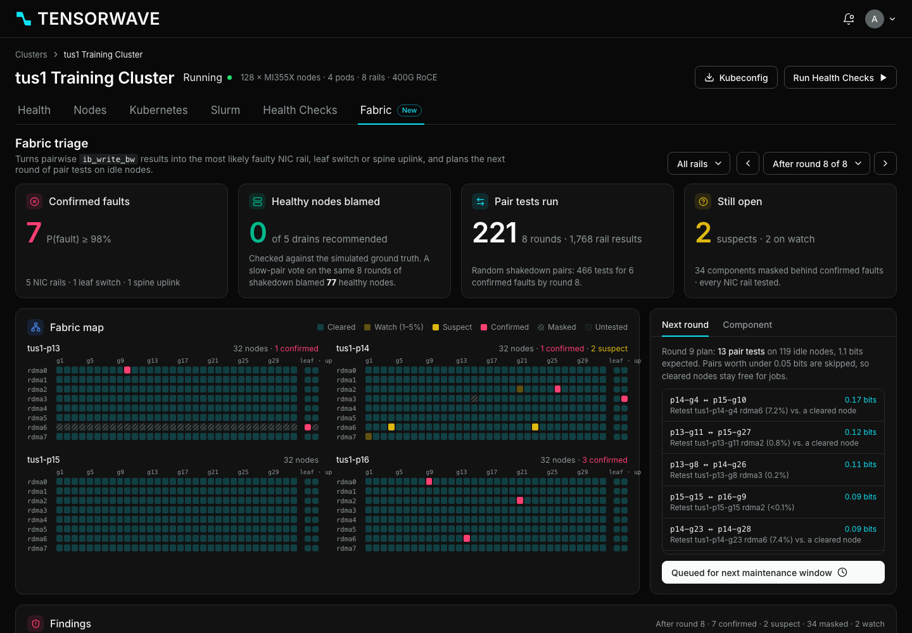

# Fabric Triage for TensorWave (concept demo)

**Live demo:** https://mohith26.github.io/tensorwave-fabric-triage/

An unofficial concept feature for the TensorWave cluster console: a **Fabric** tab that turns pairwise `ib_write_bw` results into the most likely faulty **NIC rail, leaf switch or spine uplink**, and plans the next round of pair tests on idle nodes by expected information gain.

Unofficial concept demo by Mohith Gajjela. Not affiliated with TensorWave. Synthetic data.



## Why

TensorWave's docs describe rail-optimized fabrics (one RDMA NIC per GPU, 8 rails per node, pods behind top-of-rack leaves) and multinode checks that run RCCL / IB perf "across node pairs to identify nodes with degraded interconnect performance". A slow pair result has an attribution problem:

* a slow pair implicates **both** endpoints;
* a bad leaf switch or spine uplink makes **every** node behind it look slow on that rail, so a per-node vote drains healthy nodes;
* an all-pairs sweep is quadratic (8,128 pairs for 128 nodes), and customer jobs keep some nodes busy.

Fabric Triage answers "which component is broken, how sure are we, and which pairs should we test next?"

## How it works

* **Model.** Each component (1,024 NIC rails, 32 leaf/rail switches, 32 leaf-to-spine uplink groups in the demo) is healthy, solidly faulty (degrades ~97% of tests through it) or flapping (~50%). A test of pair (i, j) on rail r crosses NIC(i,r), NIC(j,r), the leaf(s) and, for cross-pod pairs, both pods' spine uplinks. Measured bandwidth is modeled as healthy (near line rate, with 3% transient dips) unless some faulty component on the path fires, in which case it is uniformly degraded.
* **Inference.** Gibbs sampling over the 3-state component variables with Rao-Blackwellized marginals (`src/fabric.js:infer`). This gives explaining-away for free: one bad leaf explains 87 slow tests far better than 32 bad NICs. Checked against exact enumeration on a small fabric.
* **Masking.** A component whose every test also crossed a confirmed fault is reported as **masked** ("retest after the repair"), not cleared.
* **Either/or groups.** Suspects that the data cannot separate but where at least one must be faulty are shown as a pair.
* **Planning.** For every idle pair, expected information gain (mutual information between the 8 per-rail slow/fast outcomes and the component states, estimated from posterior samples, with untested components mixed in analytically). Greedy max-weight matching picks the round; pairs worth under 0.05 bits are skipped so cleared nodes stay free for jobs.
* **Baselines.** (1) the same inference on random shakedown pairings; (2) a slow-pair vote (blame a NIC rail with 2+ slow tests that are at least half its tests).

## Results (all numbers from `node scripts/report.mjs --seeds 12`)

Committed scenario (seed 20261110): 128 MI355X nodes in 4 pods, 7 hidden faults (5 NIC rails incl. one flapping link, 1 leaf with a PFC/buffer problem, 1 spine uplink down), 8 rounds with 7-19 nodes busy each round.

| | Planned pairs (this feature) | Random shakedown pairs, same inference | Slow-pair vote on random pairs |
|---|---|---|---|
| Pair tests in 8 rounds | 221 | 466 | 466 |
| Faults confirmed (P >= 98%) | 7 / 7 (by round 8) | 6 / 7 | 4 of 5 NIC faults flagged; cannot name a switch |
| Healthy nodes blamed | 0 | 0 | 77 |

Across 12 seeded clusters (8 rounds each): 75 of 84 faults confirmed, **0 false confirmations, 0 healthy nodes blamed**, mean 204 tests vs 465 for random pairings (71 of 84 confirmed). All 71 identifiable solid faults were confirmed; the misses are flapping links (4 of 12 confirmed: 3 still suspect, 3 wrongly cleared, 1 on watch, 1 masked) and one solid fault masked behind another. The vote heuristic blamed 77.8 healthy nodes per cluster on average.

## Run it

```bash
node --test test/fabric.test.mjs     # 8 tests
node scripts/report.mjs --seeds 12   # every number above
node scripts/generate.mjs > data/scenario.json   # regenerates the committed data byte-for-byte
python3 -m http.server               # then open http://localhost:8000
```

Tests cover: generator determinism vs committed data; Gibbs marginals vs exact enumeration (3^8 states); leaf-switch explaining-away (and the vote baseline blaming the whole pod); uplink vs leaf separation via intra-pod tests; masking; planner ordering and matching validity; the committed scenario end to end; no false confirmations across seeded small clusters.

## UI

The page rebuilds the console shell from public material: tokens (`#09090a` background, `#121213` cards, `#262b2b` borders, `#0de2f2` brand teal, status colors, 0.625rem radius, Inter) come from the console's public CSS bundle; layout and components follow screenshots in docs.tensorwave.com and tensorwave.com product pages (cluster header with Run Health Checks, health-check table, Health tab cards, Settings tabs). Icons are Lucide, which the console bundle also uses. The exact cluster tab set is inferred from the docs (Health, Nodes, Kubernetes, Slurm, Health Checks); the Fabric tab is new.

## Novelty

I checked TensorWave's docs (all pages in llms.txt, incl. Healthchecks, Performance/preflight, Clusters, Nodes, Notifications), product pages and recent news for fault localization, pairwise attribution, switch-level diagnosis or test planning, and found none: today's multinode checks report pair results, and `preflight` flags a link below the fleet median without saying which component. Related work elsewhere: NVIDIA's open-source cluster-readiness-engine ADR-055 uses topology-aware group testing with binary splitting to find bad nodes; Holmes (NSDI'25), SuperBench (ATC'24) and OpenAI's Clustermapper localize faults in NVIDIA fleets. Fabric Triage differs by working on continuous per-rail bandwidth with a noise model, attributing to switches and uplinks (not only nodes), reporting calibrated probabilities, masking and either/or groups, and choosing pairs by information gain under idle-node constraints.

## Honest limitations

* Synthetic data and my own fault model; real fabrics have congestion, ECMP collisions and asymmetric faults that this does not model.
* Flapping links are the weak spot (see results). TensorWave's existing `check-link-flap` counters would be the natural extra evidence to fold into the prior.
* Topology is simplified to rail-aligned leaves and one spine plane per rail; the real `topology.conf` and port maps would replace it.
* Tests are ib_write_bw-style per-rail pair tests; RCCL all-reduce results would need a different likelihood (the bottleneck rail dominates).
* Gibbs sampling is approximate; it matches enumeration on small fabrics but can mix slowly with many simultaneous switch faults.
* Runs in the browser in a few seconds for 128 nodes; a production version would run server-side next to `sdebug` results.
